# ToberStash

Local inventory and build manager for electronic components. It keeps the parts list, project BOMs, purchase orders, and the paperwork around a build on one Windows PC.

Copyright R.C. Tober AB. All rights reserved.
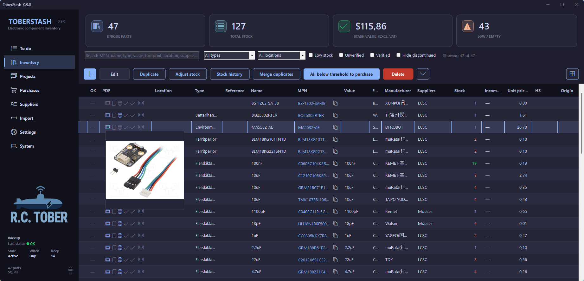

## What it does

- Inventory with stock, locations, photos, datasheets, and MPN lookup.
- Projects that turn a BOM into a build, a test protocol, and a PDF report.
- Purchase orders, receiving, and a comparison of supplier prices.
- A to-do list for low stock, overdue purchases, ready builds, and waiting tests.
- Excel and CSV import, and an inventory export.
- BOM import from EasyEDA, KiCad, or Altium.
- Pick lists, scrap, and serial numbers on a build.
- An export sheet with origin, HS, TARIC, HTSUS, and ECCN.
- Supplier cards, with part numbers and prices on the component.
- MPN lookup from LCSC, and from Mouser, DigiKey, TME, and Nexar with your own keys.
- Stock history, and a merge for rows that share an MPN.
- SQLite on the machine, or MySQL, MariaDB, or SQL Server.
- Work offline copies a server database to this PC, and copies it back when you go online again.
- JSON backup while the app is open.
- Move the component list to or from Part-DB and InvenTree.
- English, Swedish, German, French, Spanish, Polish, Danish, Norwegian Bokmål, Finnish, Hindi, Simplified Chinese, and Japanese.
- Display currencies: SEK, NOK, DKK, EUR, CHF, GBP, PLN, USD, CNY, JPY, and INR. A stored price keeps its original currency. The lists convert to the currency chosen under **Settings → Economy**.
- Prices can be shown with VAT. Stored prices stay exclusive of VAT.
- Nine display themes, and your own logo in the sidebar.

The current version is **0.9.1**. See [CHANGELOG.md](CHANGELOG.md). A longer guide is in [WIKI.md](WIKI.md).

## When the inventory outgrows this app

The component list can be moved to [Part-DB](https://github.com/Part-DB/Part-DB-server) or [InvenTree](https://inventree.readthedocs.io/). Under **System → Exchange**, export to either system. Part-DB files use semicolons. InvenTree files use commas. Prices are written as stored.

Projects, purchase orders, tests, and order documents stay in ToberStash. Import from the same menu brings a component list back.

## Install

ToberStash is a folder of files, not a setup program. It runs on 64-bit Windows.

1. Install the [.NET 10 Desktop Runtime](https://dotnet.microsoft.com/download/dotnet/10.0) (x64). 
2. Download the zip and extract the whole folder. Keep every file next to `ToberStash.exe`. The PDF reports need the native libraries that sit beside it.
3. Start `ToberStash.exe`.

Windows may say the app is unrecognized. Choose **More info**, then **Run anyway**.

The first start creates an empty inventory and a local database in `%LocalAppData%\ToberStash`. Nothing is written to the folder you extracted.

Then, in the app:

- **Settings → Language** picks the interface language. The choice is saved for the next start.
- **Settings → Economy** sets the display currency: SEK, NOK, DKK, EUR, CHF, GBP, PLN, USD, CNY, JPY, or INR. Each stored price keeps the currency it was entered in.
- **Settings → API** is optional. Part lookup works without keys for the public sources. Mouser, DigiKey, TME, and Nexar need your own keys. Those keys stay on this PC, encrypted for the Windows account.
- **System → Database** can move the inventory to MySQL, MariaDB, or SQL Server. Export a JSON backup first, switch, then import it.

To remove ToberStash, delete the extracted folder and `%LocalAppData%\ToberStash`.

## Requirements

- Windows 64-bit
- [.NET 10 Desktop Runtime](https://dotnet.microsoft.com/download/dotnet/10.0) to run the published build

## Data

The first launch uses a local SQLite file. Under **System → Database** the connection can be switched to MySQL, MariaDB, or SQL Server. Export a JSON backup before switching, then import it into the new database. **Work offline** copies a server on another machine to this PC and copies it back later. Mark that server as running on this computer, and the button stays off.

API keys for part lookup are not stored in the inventory database. They stay on that PC, encrypted for the Windows account.

## Third-party software

Copyright lines and license terms are printed at the bottom of this file. The same text is shown in the app under **System → About**.

## Version

The version shown in **System → About** comes from `ToberStash/ToberStash.csproj`.

## Images

Inventory list:

Component card: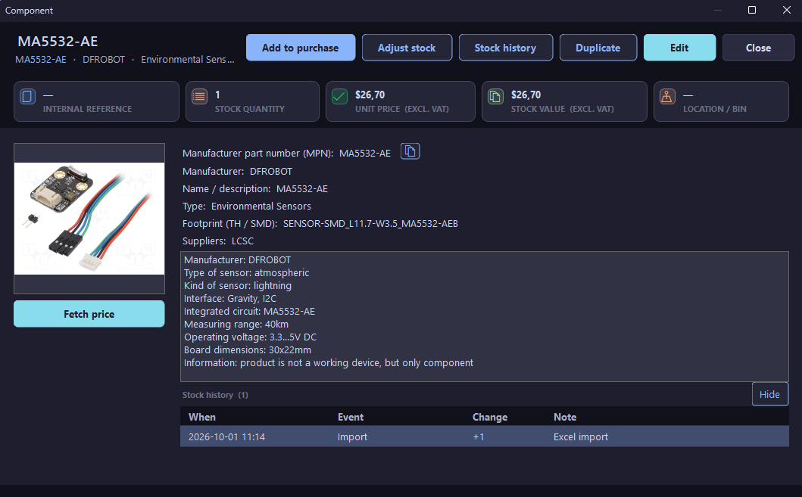

Project management: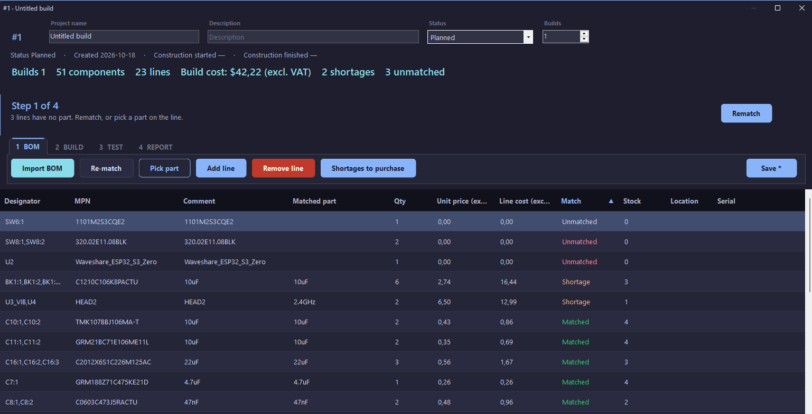

Supplier management: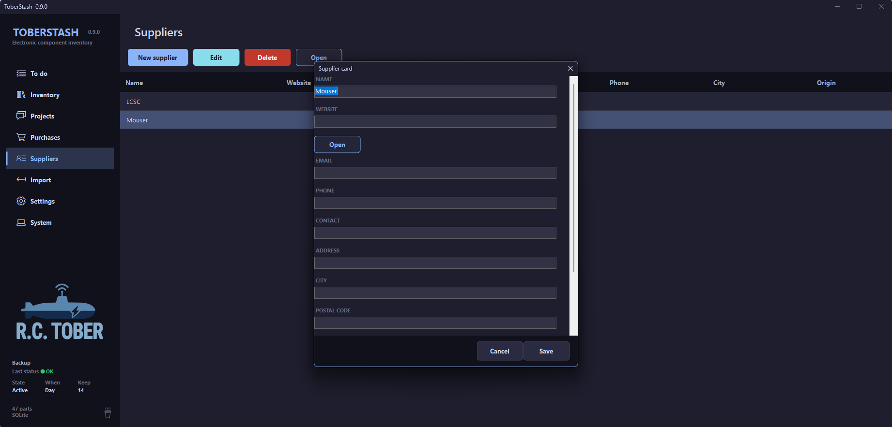

Purchase order management: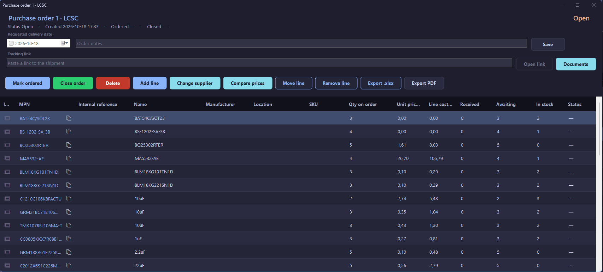

Build report: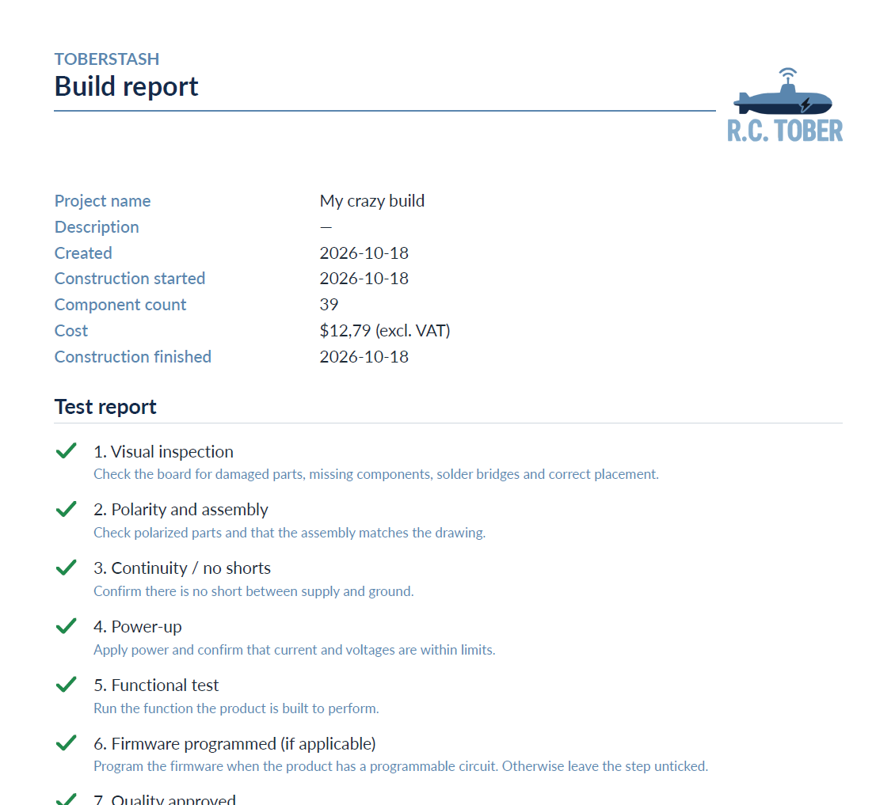

Display settings: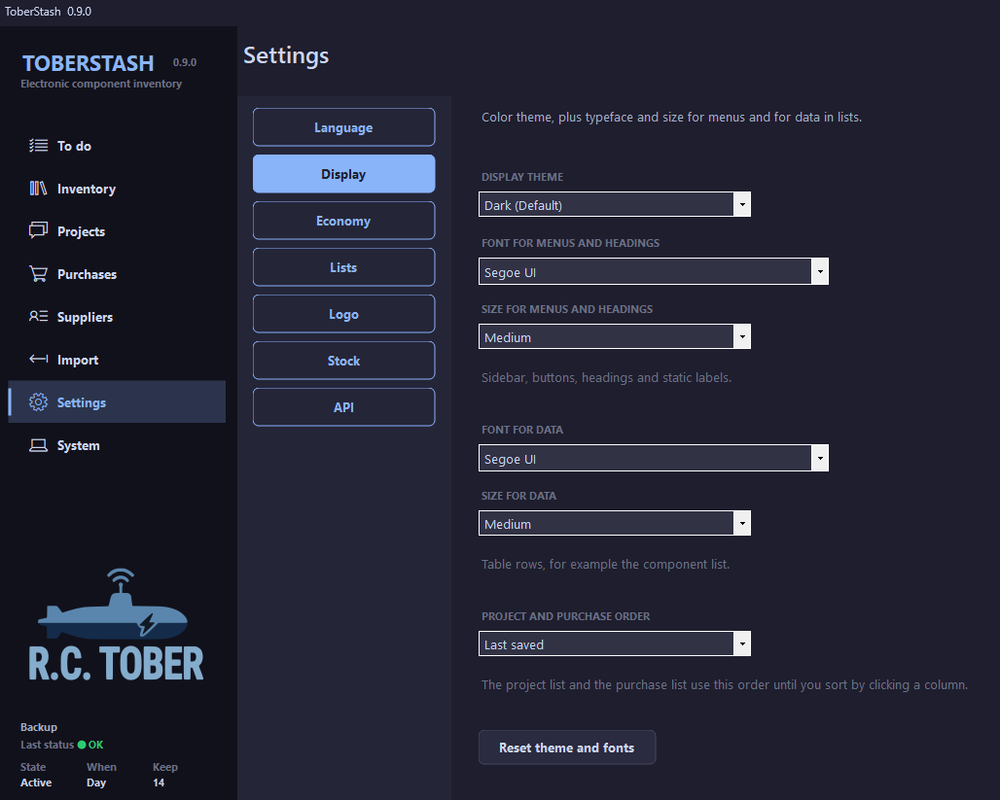

System settings: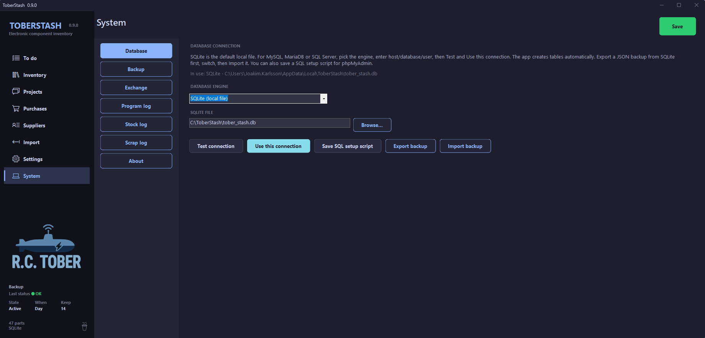

Logo settings: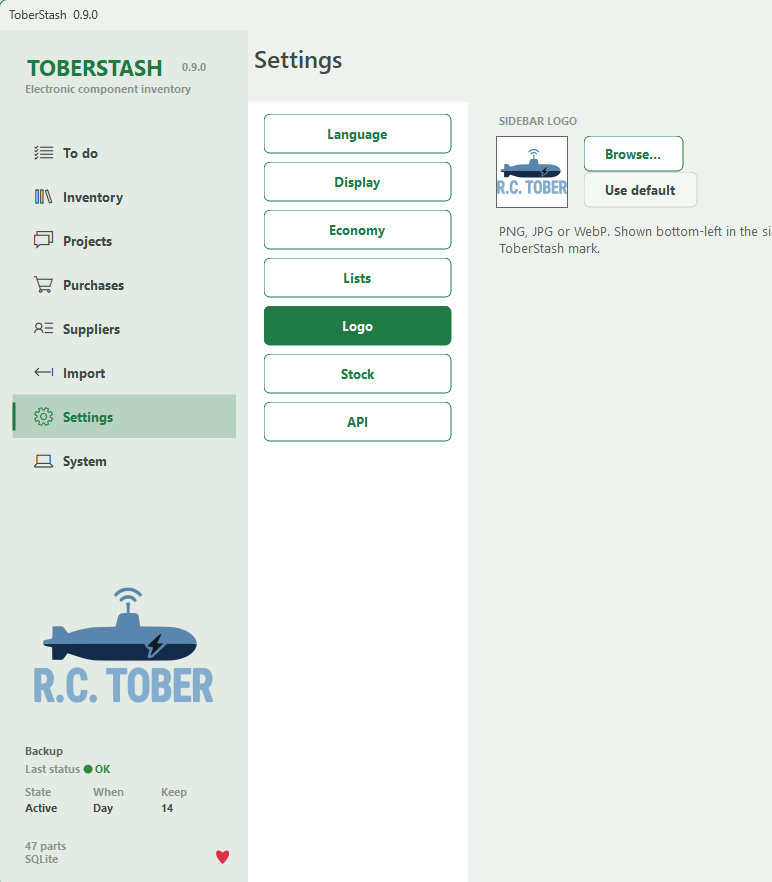

Automatic and manual backup: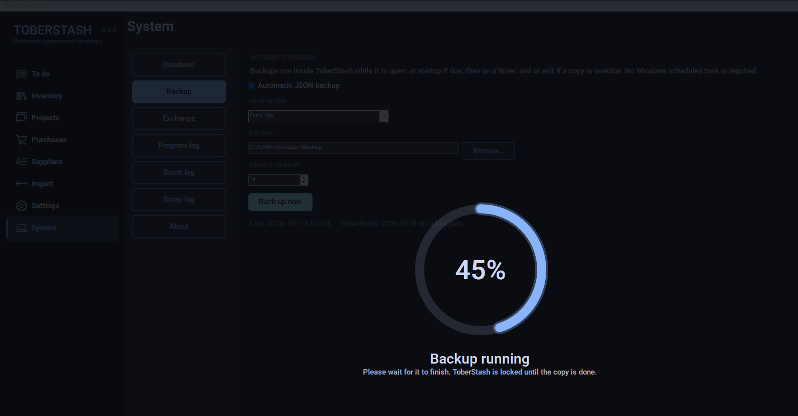

9 Themes built in: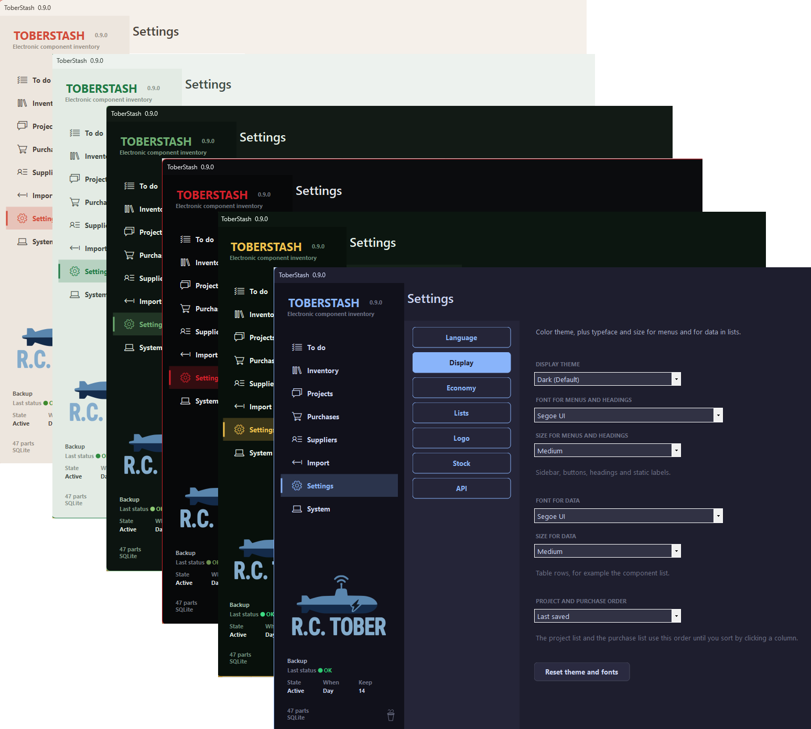

## In more detail

- **To do.** The start page lists parts below the reorder point, overdue purchases, builds that have the parts they need, and projects waiting for a test.
- **Inventory.** One row per component, with MPN, name, value, footprint, manufacturer, stock, and a storage location of up to three levels, such as a row, a shelf, and a box. Search across those fields, and filter by type, location, low stock, verified, or discontinued. Choose which columns the table shows, and in which order. Adjust stock and read the stock history. Merge rows that share an MPN. Attach photos, a datasheet, and RoHS, REACH, and RED/EMC documents.
- **Part lookup.** Type an MPN and fill empty fields from LCSC, or from Mouser, DigiKey, TME, and Nexar when you add your own keys. The same lookup can refresh prices. A value already on the component is left as it is, unless you pick a replacement yourself. The keys stay on this PC, encrypted for the Windows account.
- **Projects.** Import a BOM from EasyEDA, KiCad, or Altium, or add lines from the inventory. Unmatched lines and shortages are shown before the build. The pick list is sorted by location. Running the build deducts stock, and undoing it puts the stock back. A build can start before serial numbers exist, and the project stays open until every serial-tracked part has one. Scrap can be registered for parts on the BOM and for parts that were not. The test follows the steps defined under **Settings → Lists**, with a comment on each step. A completed build locks the cost and writes a PDF report, plus an export sheet with origin, HS, TARIC, HTSUS, and ECCN.
- **Purchases.** Purchase orders move through open, ordered, and closed. Receive a line when it arrives, keep a requested delivery date and a tracking link, and store the invoice, receipt, and mail on the order. Shortages from a project, and every part below its reorder point, can be added to an order. Compare the saved price at each supplier, and move a line to another order.
- **Suppliers.** Each supplier has a card with website, contact, and address. Part numbers and prices for that supplier are stored on the component.
- **Database.** The first start uses a SQLite file on the machine. **System → Database** can switch to MySQL, MariaDB, or SQL Server, and the tables are created on that server. **Work offline** copies a server on another machine to this PC and copies it back when you go online. The mode is shown at the bottom of the sidebar. The button stays off for SQLite and for a server marked as running on this computer. A JSON backup runs while ToberStash is open. The component list can be moved to or from Part-DB and InvenTree.
- **Language and money.** English, Swedish, German, French, Spanish, Polish, Danish, Norwegian Bokmål, Finnish, Hindi, Simplified Chinese, and Japanese. Display currencies: SEK, NOK, DKK, EUR, CHF, GBP, PLN, USD, CNY, JPY, and INR. A stored price keeps the currency it was entered in. Lists, cards, and project cost convert to the currency chosen under **Settings → Economy**. Prices can be shown with VAT. The stored price stays exclusive of VAT.

## Support

If ToberStash is useful, you can [buy the author a coffee](https://buymeacoffee.com/rctober).

[](https://buymeacoffee.com/rctober)

## Third-party notices

```
ToberStash includes the third-party software listed below. The license texts are in English.

QuestPDF 2025.12.3
PDF documents.
Copyright Marcin Ziąbek and QuestPDF contributors.
QuestPDF Community MIT License. That grant applies when annual gross revenue is under 1,000,000 USD.
https://www.questpdf.com/

Six Labors ImageSharp 3.1.12
Image handling.
Copyright © Six Labors.
Six Labors Split License. For a for-profit organisation with annual gross revenue under 1,000,000 USD, this direct dependency is licensed under the Apache License 2.0.
https://github.com/SixLabors/ImageSharp

ClosedXML 0.105.0
Excel files.
MIT License. Copyright ClosedXML contributors.
https://github.com/ClosedXML/ClosedXML

DocumentFormat.OpenXml
Excel file format, used by ClosedXML.
MIT License. © Microsoft Corporation.

ExcelNumberFormat 1.1.0
Used by ClosedXML.
MIT License.

Dapper 2.1.66
Database access.
Apache License 2.0. Copyright 2019 Stack Exchange, Inc.
https://github.com/DapperLib/Dapper

Microsoft.Data.Sqlite 10.0.0
SQLite access.
MIT License. © Microsoft Corporation.

Microsoft.Data.SqlClient 6.1.1
SQL Server access.
MIT License. © Microsoft Corporation.

MySqlConnector 2.4.0
MySQL and MariaDB access.
MIT License. Copyright 2016–2024 Bradley Grainger.
https://mysqlconnector.net/

SQLitePCLRaw.bundle_e_sqlite3 3.0.0
SQLite native library.
Apache License 2.0. Copyright 2014–2025 SourceGear, LLC.
Includes SQLite, which is in the public domain.
https://sqlite.org/copyright.html

BouncyCastle.Cryptography
Used by Microsoft.Data.SqlClient.
MIT License. Copyright © Legion of the Bouncy Castle Inc.

.NET runtime
Shipped with this application.
MIT License. © Microsoft Corporation.
https://github.com/dotnet/runtime

MIT License

Permission is hereby granted, free of charge, to any person obtaining a copy of this software and associated documentation files (the "Software"), to deal in the Software without restriction, including without limitation the rights to use, copy, modify, merge, publish, distribute, sublicense, and/or sell copies of the Software, and to permit persons to whom the Software is furnished to do so, subject to the following conditions:

The above copyright notice and this permission notice shall be included in all copies or substantial portions of the Software.

THE SOFTWARE IS PROVIDED "AS IS", WITHOUT WARRANTY OF ANY KIND, EXPRESS OR IMPLIED, INCLUDING BUT NOT LIMITED TO THE WARRANTIES OF MERCHANTABILITY, FITNESS FOR A PARTICULAR PURPOSE AND NONINFRINGEMENT. IN NO EVENT SHALL THE AUTHORS OR COPYRIGHT HOLDERS BE LIABLE FOR ANY CLAIM, DAMAGES OR OTHER LIABILITY, WHETHER IN AN ACTION OF CONTRACT, TORT OR OTHERWISE, ARISING FROM, OUT OF OR IN CONNECTION WITH THE SOFTWARE OR THE USE OR OTHER DEALINGS IN THE SOFTWARE.

Apache License 2.0

Components marked Apache License 2.0 are licensed under the Apache License, Version 2.0.
You may obtain a copy of the License at

http://www.apache.org/licenses/LICENSE-2.0

Unless required by applicable law or agreed to in writing, software distributed under the License is distributed on an "AS IS" BASIS, WITHOUT WARRANTIES OR CONDITIONS OF ANY KIND, either express or implied. See the License for the specific language governing permissions and limitations under the License.
```
